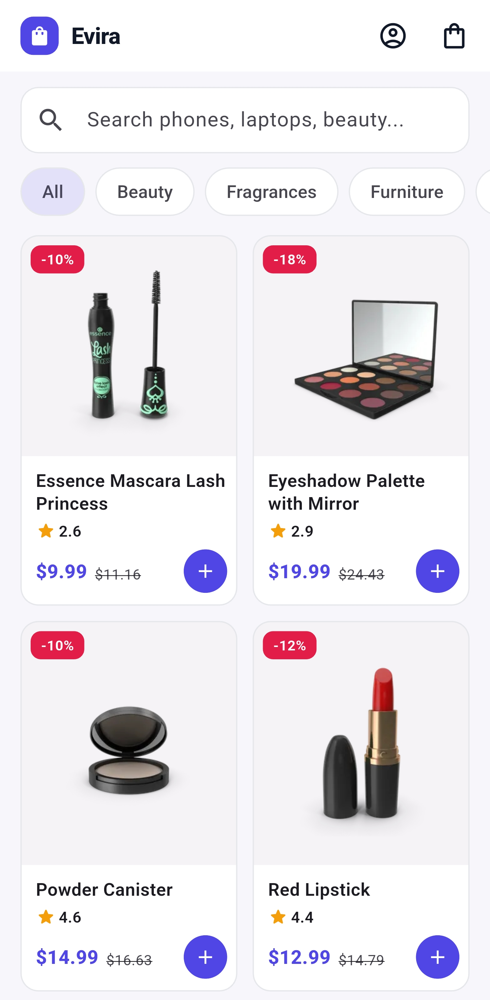
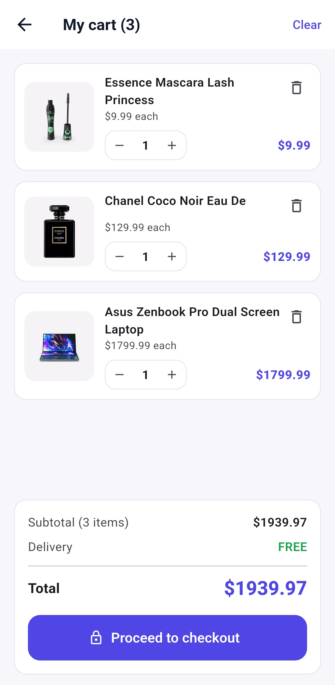
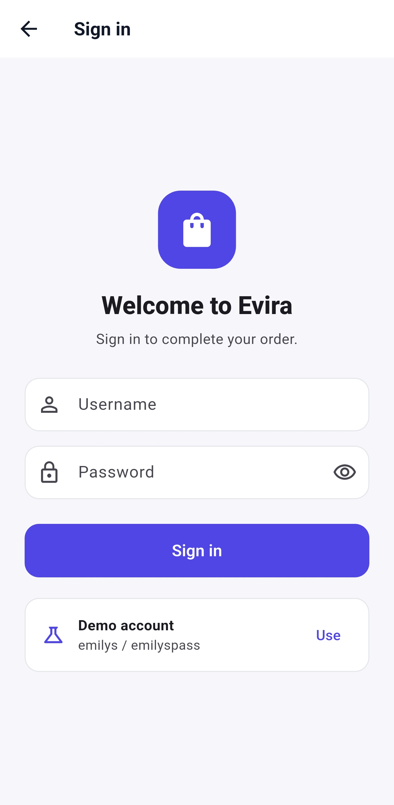
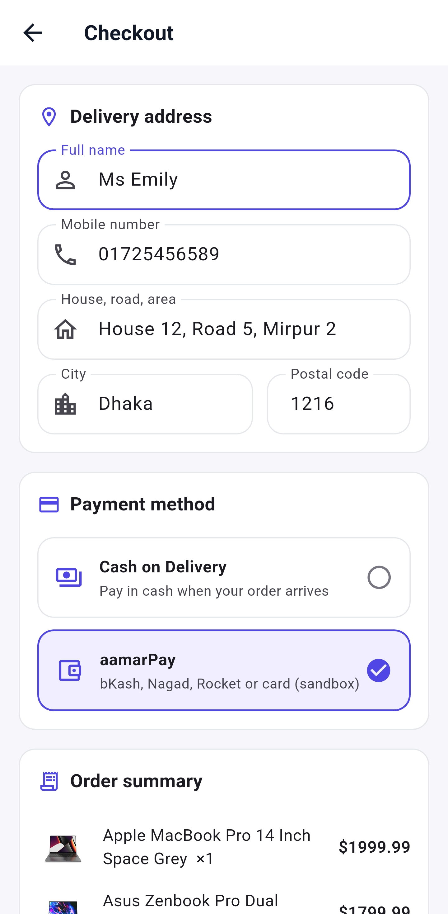
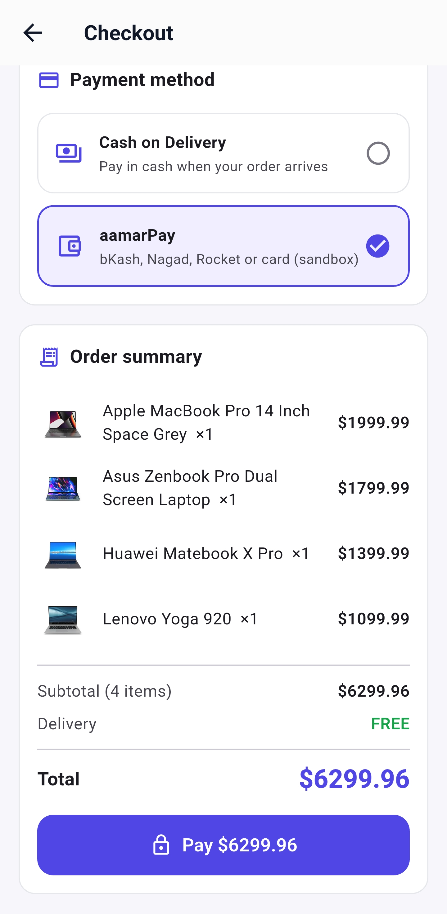
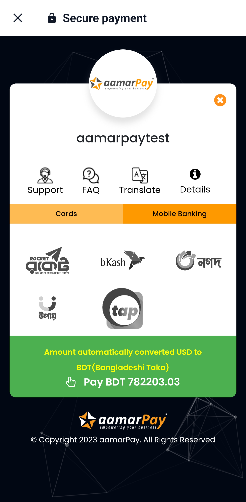
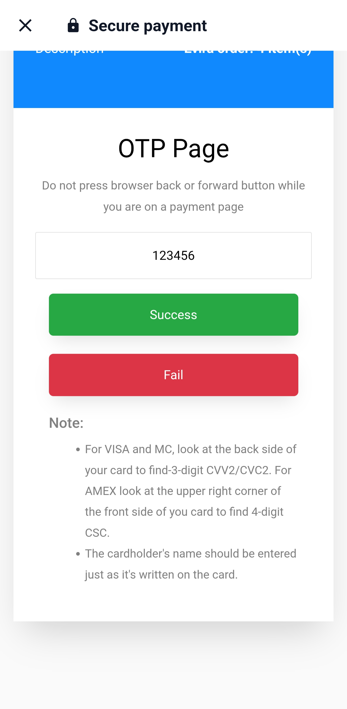
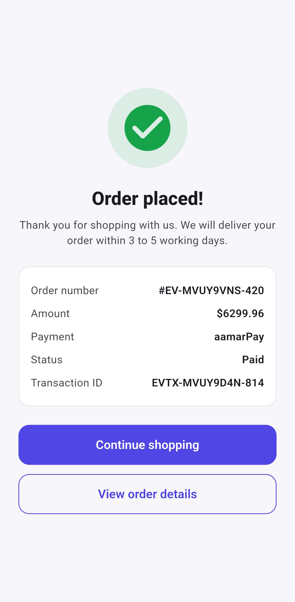
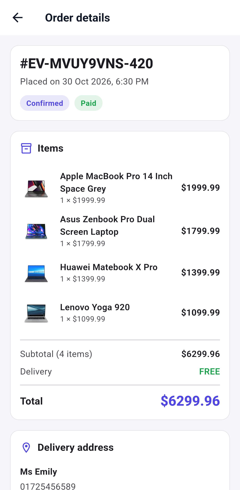

# Evira

A Flutter e-commerce app for Android and iOS with a product catalog, a persistent
cart, sign-in, checkout with Cash on Delivery or aamarPay, and order history.


## Contents

- [Overview](#overview)
- [Screenshots](#screenshots)
- [Features](#features)
- [Tech stack](#tech-stack)
- [Getting started](#getting-started)
- [Configuration](#configuration)
- [Demo account](#demo-account)
- [Testing aamarPay](#testing-aamarpay)
- [Running tests](#running-tests)
- [Known limitations](#known-limitations)
- [Author](#author)

## Overview

Evira covers the full shopping flow of a mobile store:

1. **Browse** products from the [DummyJSON](https://dummyjson.com) catalog, search them and filter by category.
2. **Add to cart.** The cart is saved on the device, so it survives app restarts.
3. **Sign in.** Checkout, orders and profile are protected; after signing in, the user returns to where they were.
4. **Check out.** Enter a delivery address and choose Cash on Delivery or aamarPay.
5. **Pay online.** aamarPay's hosted payment page opens inside the app. The app detects whether the payment succeeded, failed or was cancelled.
6. **Track orders.** Every order gets a confirmation screen and appears in the order history with its payment status.

The code is organised by feature (products, cart, auth, orders, payment), with
state managed by Provider and data loaded through repository classes, which keeps
each feature easy to test.

## Screenshots

<table>
  <tr>
    <td align="center"><br/><sub>Home</sub></td>
    <td align="center"><br/><sub>Product details</sub></td>
    <td align="center"><br/><sub>Cart</sub></td>
    <td align="center"><br/><sub>Sign in</sub></td>
  </tr>
  <tr>
    <td align="center"><br/><sub>Checkout</sub></td>
    <td align="center"><br/><sub>Order summary</sub></td>
    <td align="center"><br/><sub>aamarPay payment</sub></td>
    <td align="center"><br/><sub>Sandbox OTP</sub></td>
  </tr>
  <tr>
    <td align="center"><br/><sub>Order placed</sub></td>
    <td align="center"><br/><sub>Order details</sub></td>
  </tr>
</table>

## Features

**Catalog**
- Product grid with search, category filters and pull-to-refresh
- Product details with image gallery, discount price, stock status, warranty, shipping and return information, and customer reviews
- Loading, empty and error states with retry

**Cart**
- Add, update and remove items, with swipe-to-delete and undo
- Quantity limited to available stock
- Free-delivery progress bar (free delivery on orders over $50, otherwise $4.99)
- Saved on the device across app restarts

**Account**
- Sign in with the DummyJSON API and automatic session restore on launch
- Profile page with contact details, order count and sign out
- Light, dark or system theme, remembered between launches

**Checkout and payment**
- Delivery address form with validation, including Bangladeshi mobile numbers
- Cash on Delivery or aamarPay (bKash, Nagad, Rocket or card in sandbox mode)
- aamarPay payment page in a WebView, with success, failure and cancellation handling
- Orders paid online are saved with the status **Paid** and a transaction ID

**Orders**
- Order confirmation with order number, amount, payment method and status
- Order history and order details
- Orders are saved to a local API and on the device, so history still works when the API is offline

**Layout**
- Responsive layouts for phones, tablets and landscape, including two-column views for cart, checkout and product details on wide screens

## Tech stack

| Purpose | Package / service |
| --- | --- |
| Framework | [Flutter](https://flutter.dev) (Dart 3.11+) |
| State management | [provider](https://pub.dev/packages/provider) |
| Navigation and route guards | [go_router](https://pub.dev/packages/go_router) |
| HTTP client | [dio](https://pub.dev/packages/dio) |
| Local storage | [shared_preferences](https://pub.dev/packages/shared_preferences) |
| Image caching | [cached_network_image](https://pub.dev/packages/cached_network_image) |
| Payment page | [webview_flutter](https://pub.dev/packages/webview_flutter) |
| Products and sign-in | [DummyJSON](https://dummyjson.com) |
| Online payment | [aamarPay sandbox](https://sandbox.aamarpay.com) |
| Order storage | [json-server](https://github.com/typicode/json-server) (in [`mock_server/`](mock_server)) |

## Getting started

### Requirements

- [Flutter SDK](https://docs.flutter.dev/get-started/install) (stable channel, Dart 3.11 or newer)
- Android Studio or VS Code, with an Android emulator, iOS simulator or physical device
- [Node.js](https://nodejs.org), for the local order API

### Installation

```bash
git clone https://github.com/ssheikhs/Evira-Ecommerce-App.git
cd Evira-Ecommerce-App
flutter pub get
```

### Start the order API

```bash
cd mock_server
npm install
npm start
```

The API runs on `http://localhost:3001`. The app still works without it and keeps
orders on the device.

### Run the app

```bash
flutter run
```

## Configuration

Settings are passed with `--dart-define`, so no code changes are needed.

| Setting | Default | Purpose |
| --- | --- | --- |
| `ORDER_API_URL` | `http://10.0.2.2:3001` (Android emulator), `http://localhost:3001` (iOS simulator) | Address of the order API |
| `AAMARPAY_STORE_ID` | `aamarpaytest` | aamarPay store ID |
| `AAMARPAY_SIGNATURE_KEY` | aamarPay public sandbox key | aamarPay signature key |

**Physical Android phone over USB:**

```bash
adb reverse tcp:3001 tcp:3001
flutter run --dart-define=ORDER_API_URL=http://localhost:3001
```

**Physical phone on the same Wi-Fi as the computer:**

```bash
flutter run --dart-define=ORDER_API_URL=http://<your-computer-ip>:3001
```

See [`mock_server/README.md`](mock_server/README.md) for more about the order API.

## Demo account

| Username | Password |
| --- | --- |
| `emilys` | `emilyspass` |

The sign-in screen has a **Use** button that fills in these credentials.

## Testing aamarPay

1. Add items to the cart and open **Checkout**.
2. Fill in the delivery address with a valid Bangladeshi mobile number, for example `01712345678`.
3. Choose **aamarPay** and tap **Pay**.
4. On the sandbox page, choose a card or mobile banking option, such as bKash.
5. On the sandbox OTP page, tap **Success** for a paid order or **Fail** to test a failed payment.
6. After a successful payment, the app shows **Order placed!** with the status **Paid** and the transaction ID.

No real money is charged. The app uses aamarPay's public sandbox credentials; for
a live store, pass your own keys with the settings in [Configuration](#configuration).

## Running tests

```bash
flutter analyze
flutter test
```

The tests cover models and JSON parsing, cart rules (quantities, stock limits and
delivery fee), authentication, the order and payment flow with fake repositories,
form validators and a widget.

## Known limitations

- **Demo sign-in only.** DummyJSON accepts its own test users, so there is no sign-up screen.
- **Sandbox payments.** Payments use aamarPay's sandbox, and the app marks an order as paid based on the gateway's redirect. A production app should confirm each transaction on its own server before marking it paid.
- **Currency conversion.** Prices are sent to aamarPay in USD and converted to BDT by aamarPay. If the sandbox's exchange-rate service is unavailable, its payment page can show BDT 0.00; trying again later resolves it.
- **Local order API.** Orders are stored by a local json-server for development, not a production backend.

## Author

**Sheikh Sazzaduzzaman**

- GitHub: [@ssheikhs](https://github.com/ssheikhs)
- LinkedIn: [sheikhsazzaduzzaman](https://www.linkedin.com/in/sheikhsazzaduzzaman)
